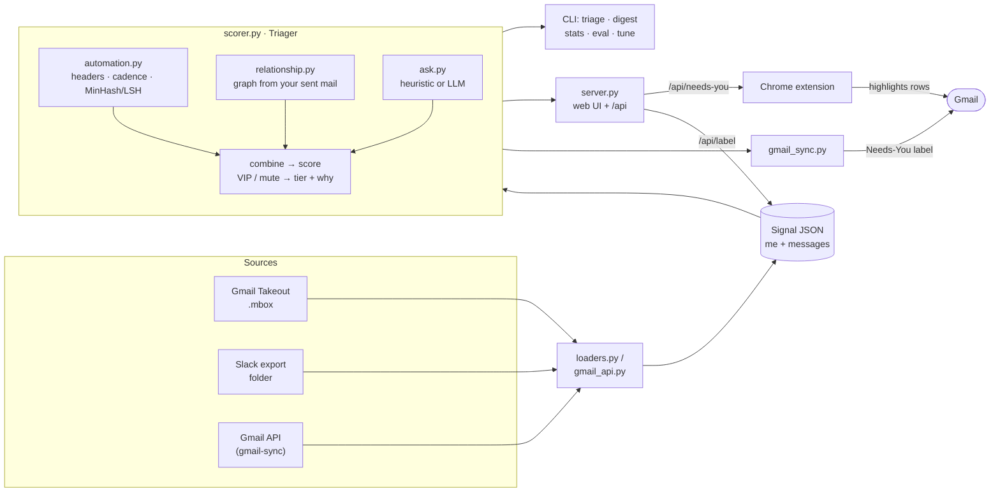

# Signal

**Most of your inbox is bots, notifications and AI agents. Signal finds the few messages that actually need you.**


## 30-second quick start

Python 3.10+, no dependencies, no API keys, no install step:

```bash
git clone https://github.com/Ishan819/signalbox.git && cd signalbox
python -m signalbox generate --out demo_inbox.json   # a labeled synthetic inbox
python -m signalbox serve demo_inbox.json            # open http://127.0.0.1:8000
```

That's the ranked demo inbox: **Needs you** at the top, **Worth a look** under it, everything
automated folded away, and a one-line reason on every message. To use your own mail, see
[Use your real data](#use-your-real-data) or [Gmail live mode](#gmail-live-mode).

## The idea

Most "AI vs. human" filters try to detect AI-*written text*. That approach is unreliable, and it gets the
wrong answer anyway: your sister may draft an email with AI, and that email still needs you. Signal asks a
different question:

> **Does this message need *me*, and is it from someone I actually have a relationship with?**

It combines three independent signals, and every decision comes with an explanation:

| Signal | What it uses | Why it's hard to fake |
|---|---|---|
| **Automation** | `List-Unsubscribe`, `Auto-Submitted`, `Precedence`, bulk-platform headers, `noreply@` senders, Slack `bot_id`, clockwork send cadence, one-way high-volume senders, and **cross-inbox template detection** (MinHash + LSH), which catches "personalized" AI sales agents that send no bulk headers | The checks run on transport metadata and patterns across your whole inbox, not on one message's wording |
| **Relationship** | Built only from **your own behaviour**: who you write to, how often, how recently, which threads you're in, and which orgs your contacts belong to | An agent can't make you have emailed it 14 times |
| **Ask** | Is it directed at you (To vs. CC vs. list, @mention, DM), does it contain a question or request, is there a deadline? Uses heuristics offline, or an **LLM** (Anthropic or Gemini) | The LLM only runs on messages that aren't already obviously automated, which keeps costs low |

```
priority = (1 - automation)^1.5 × (0.12 + 0.53·ask + 0.35·relationship)
```

## How it works



1. **Normalize.** Every source becomes the same `Message` (sender, recipients, cc, subject, body,
   headers, thread, timestamp) plus an `Identity` that lists your own addresses. Everything after this
   step works the same for email and Slack.
2. **Look at the whole inbox, not one message.** The automation analyzer indexes every message body with
   MinHash/LSH, so 40 "personalized" pitches built from one template find each other even without bulk
   headers. It also checks send cadence and whether a sender ever gets a reply. The relationship graph
   is built only from mail *you* sent: who you write to, how often, how recently, and in which threads.
3. **Score each inbound message** on the three signals (0–1 each, every one with reasons). An AI
   assistant that says it writes for someone in your graph ("I'm Priya Shah's assistant") is linked back
   to that person, and its automation penalty drops to 30%.
4. **Combine** with the formula above. **VIP** senders and domains get at least the needs-you score;
   **muted** ones get multiplied by 0.1.
5. **Tier and explain.** A score of 0.50 or more is *needs you*, 0.22 or more is *worth a look*, and
   anything lower is filtered out. The thresholds are `NEEDS_YOU` / `WORTH_A_LOOK` in `scorer.py`;
   `signalbox tune` suggests better ones from your labels. Every result gets a one-line reason such as
   "Priya (you wrote 14 times) · asks you a direct question · deadline: Tuesday".
6. **Act on it.** Print it (`triage`, `digest`), label it in Gmail (`gmail-sync`), highlight it in Gmail
   web (Chrome extension), or label it yourself in the web UI. Your labels feed `eval`, `tune` and
   `--learn`.

## Results (synthetic benchmark: 186 inbound messages, 8 actually important)

| signals used | P@2 | R@5 | R@10 | avg precision | flag precision | flag recall |
|---|---|---|---|---|---|---|
| automation only | 0.00 | 0.00 | 0.12 | 0.30 | 0.44 | 0.88 |
| + relationship | 0.00 | 0.12 | 0.62 | 0.47 | 0.57 | 1.00 |
| **+ ask (full)** | **1.00** | **0.62** | **1.00** | **0.99** | **0.89** | **1.00** |
| learned weights (4-fold CV) | 1.00 | 0.62 | 1.00 | 0.99 | 0.67 | 1.00 |

Reproduce with `python -m signalbox generate && python -m signalbox eval demo_inbox.json --learn`. CI runs
the same benchmark on every push. Ties are broken pessimistically, so a configuration can't look good just
because of the order of equal scores.

**Takeaways.** Automation signals alone can remove the bots, but they can't tell your sister's "lol look at
this cat" apart from her "are you coming home for Thanksgiving? need to book by Tuesday". You need all three
signals.

**Agents acting for people you know.** "Hi, I'm Priya Shah's AI assistant…" looks like a bot, but it's
really Priya. Signal ties the agent back to Priya in the relationship graph and softens the automation
penalty, so this message still lands in "needs you".

**Learned weights** match the hand-set formula on ranking. They raise more false alarms because the model
weights the rare important class up. On a real inbox with more labels, use `signalbox tune` to pick the cut-off.

**Known failure (kept in on purpose):** a one-off, hand-written AI outreach email with no headers, no
template twins and no disclosure ("Rex Morgan") still gets flagged by the offline heuristics. `--llm`
mode is designed to catch this case.

> ⚠️ This benchmark is synthetic, and the weights were tuned on it. No real-inbox numbers have been
> published yet. The real test is your own inbox: import it, label about 300 messages in the UI, and run
> `eval`. Report *those* numbers.

## All commands

```bash
python -m signalbox generate --out demo_inbox.json   # labeled demo inbox
python -m signalbox serve demo_inbox.json            # http://127.0.0.1:8000
python -m signalbox eval demo_inbox.json             # metrics + ablation table
python -m signalbox triage demo_inbox.json --top 10  # terminal view (add --json for scripts)
python -m signalbox digest demo_inbox.json           # short Markdown summary of what needs you
python -m signalbox stats demo_inbox.json            # who floods your inbox (unsubscribe candidates)
python -m signalbox eval demo_inbox.json --learn     # also fit weights on your labels
python -m signalbox tune demo_inbox.json             # suggest a needs-you threshold
```

**Overrides:** `--vip boss@corp.com` or `--vip @corp.com` always surfaces a sender or a whole domain;
`--mute` always buries one. Both work with `triage`, `digest`, `stats` and `serve`.

**In the UI:** <kbd>/</kbd> search, <kbd>j</kbd>/<kbd>k</kbd> move, <kbd>y</kbd> needs me, <kbd>n</kbd> doesn't.

## Use your real data

```bash
# Gmail: takeout.google.com → Mail → .mbox (include Sent so the relationship graph works)
python -m signalbox import-mbox All\ mail.mbox --me you@gmail.com --name "Your Name" --out me.json --limit 3000

# Slack: workspace export folder (unzipped); --me is your Slack user id (U0123...)
python -m signalbox import-slack ./slack-export --me U0123ABC --name "Your Name" --out slack.json

python -m signalbox serve me.json          # click "needs me" / "doesn't" to label → builds your eval set
python -m signalbox eval me.json
```

Exports are often messy. Messages that can't be parsed, broken Slack day files, and messages with no
timestamp are skipped, with one warning that lists them. A path that doesn't exist is an error, not an
empty inbox.

### LLM mode

```bash
export ANTHROPIC_API_KEY=...   # or GEMINI_API_KEY=...
python -m signalbox eval me.json --llm anthropic      # or --llm gemini
# optional: SIGNAL_MODEL=<model name> to override the default model
```

Results are cached in `.signal_cache.json`. If the LLM fails, Signal falls back to the heuristics, so
triage never goes down.

## Gmail live mode

Signal can watch your Gmail inbox and apply a `Needs-You` label to the messages that need you, without
any mbox export. It talks to the Gmail API with plain `urllib`, with no `google-api-python-client`
dependency, following the same "stdlib only" rule as everything else here.

```bash
# one-time setup: console.cloud.google.com -> new project -> enable the "Gmail API" ->
# OAuth consent screen (you can leave it in "Testing") -> Credentials -> Create OAuth client ID,
# type "Desktop app". Copy the client ID and secret it gives you.
python -m signalbox gmail-auth --client-id ... --client-secret ...   # opens a browser, saves gmail_token.json

python -m signalbox gmail-sync                 # one sync pass
python -m signalbox gmail-sync --dry-run        # preview what would be labeled, touches nothing
python -m signalbox gmail-sync --watch          # keep syncing every --interval seconds (default 600 = 10 min)
```

The OAuth scope requested is `gmail.modify`. Signal can read mail and add or remove labels, but it can't
delete anything or send mail as you. Each sync pulls recent inbox and sent mail (`--query`, default
`newer_than:7d`) into a local cache (`--cache`, default `gmail_cache.json`). The cache is a normal Signal
JSON file, so you can point `triage`, `eval` or `serve` at it like any other inbox. A `.labeled.json`
sidecar tracks what's already been labeled, so re-running (or `--watch`) never touches a message twice.

**When things go wrong:**

- **Rate limits and Google errors:** 429 and 5xx responses are retried with backoff.
- **One bad message:** a message that won't fetch, or a label that won't apply, is reported as a warning
  and retried on the next sync.
- **Corrupt cache:** a corrupt cache file is set aside as `*.corrupt-<time>` and rebuilt.
- **Revoked or expired credentials:** a one-line error tells you to run `gmail-auth` again, and
  `--watch` stops instead of retrying every 10 minutes. Apps left in "Testing" get refresh tokens that
  expire after 7 days.

## Chrome extension (Gmail web)

`extension/` is a Manifest V3 extension that marks needs-you rows (orange) and worth-a-look rows (amber)
right in the Gmail inbox, with Signal's reason as a tooltip. It reads from your local `signalbox serve`
only, and doesn't send your mail anywhere.

```bash
python -m signalbox gmail-sync --watch &           # keeps gmail_cache.json current
python -m signalbox serve gmail_cache.json         # the extension reads /api/needs-you from here
# chrome://extensions → Developer mode → Load unpacked → pick the extension/ folder
```

[extension/README.md](extension/README.md) covers permissions, how rows are matched, and what to check
if Gmail changes its markup.

## Layout

```
signalbox/
  automation.py    signal 1: headers, bot flags, cadence, MinHash/LSH template detection
  relationship.py  signal 2: graph built from your sent mail + threads, agent → contact linking
  ask.py           signal 3: heuristic + LLM ask detection (Anthropic / Gemini over HTTPS)
  scorer.py        combines the signals → score, tier, one-line explanation
  evaluate.py      P@k, R@k, average precision, flag precision/recall, ablation, threshold tuning
  learn.py         pure-Python logistic regression, k-fold cross-validation
  digest.py        daily summary of what needs you
  stats.py         noisiest senders and which automation signals fire
  synth.py         labeled synthetic inbox with deliberate hard cases
  loaders.py       Signal JSON, mbox (Gmail Takeout), Slack export
  server.py        zero-dependency web UI with one-click labeling, /api/needs-you feed
  gmail_auth.py    Gmail live mode: OAuth (local-loopback flow with PKCE, token refresh)
  gmail_api.py     Gmail live mode: REST client with retries, Gmail message → Signal Message
  gmail_sync.py    Gmail live mode: cache + score + label, one-shot or --watch
extension/         Chrome extension (Manifest V3) that highlights needs-you rows in Gmail web
tests/             pytest suite (python -m pytest -q); extension tests: node --test extension/tests/*.test.js
```

## Contributing

See [CONTRIBUTING.md](CONTRIBUTING.md). The short version: the Python package is standard library only,
and both test suites must pass.

## License

[MIT](LICENSE) © 2026 Ishan Mishra

## Roadmap

- [x] Learn the weights from labels (logistic regression, cross-validated)
- [x] Link AI assistants back to the contact they act for
- [x] Daily digest, inbox stats, VIP/mute lists, threshold tuning
- [x] **Gmail live mode**: Gmail API + OAuth, apply a `Needs-You` label every 10 minutes
- [x] **Chrome extension for Gmail web**: highlight needs-you messages in the inbox
- [x] Hardened sync and importers: retries, corrupt-file recovery, malformed exports
- [ ] Chrome extension for **Slack web**
- [ ] Publish the extension to the Chrome Web Store
- [ ] Benchmark on a real, hand-labeled inbox and publish those numbers
