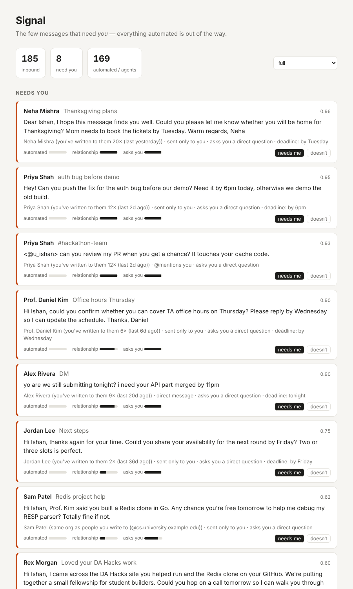

# Signal

**Out of 100 messages, 90 come from bots, AI agents, and automations. Signal finds the 2 that actually need you.**



## The idea

Most "AI vs. human" filters try to detect AI-*written text*. That approach is unreliable, and it gets the
wrong answer anyway: your sister may draft an email with AI, and that email still needs you. Signal asks a
different question:

> **Does this message need *me*, and is it from someone I actually have a relationship with?**

It combines three independent signals, and every decision comes with an explanation:

| Signal | What it uses | Why it's hard to fake |
|---|---|---|
| **Automation** | `List-Unsubscribe`, `Auto-Submitted`, `Precedence`, bulk-platform headers, `noreply@` senders, Slack `bot_id`, clockwork send cadence, one-way high-volume senders, and **cross-inbox template detection** (MinHash + LSH), which catches "personalized" AI sales agents that send no bulk headers | The checks run on transport metadata and patterns across your whole inbox, not on one message's wording |
| **Relationship** | Built only from **your own behaviour**: who you write to, how often, how recently, which threads you're in, and which orgs your contacts belong to | An agent can't make you have emailed it 14 times |
| **Ask** | Is it directed at you (To vs. CC vs. list, @mention, DM), does it contain a question or request, is there a deadline? Uses heuristics offline, or an **LLM** (Anthropic or Gemini) | The LLM only runs on messages that aren't already obviously automated, which keeps costs low |

```
priority = (1 - automation)^1.5 × (0.12 + 0.53·ask + 0.35·relationship)
```

## Results (synthetic benchmark: 185 inbound messages, 7 actually important)

| signals used | P@2 | R@5 | R@10 | avg precision | flag precision | flag recall |
|---|---|---|---|---|---|---|
| automation only | 0.00 | 0.00 | 0.14 | 0.29 | 0.44 | 1.00 |
| + relationship | 0.00 | 0.14 | 0.71 | 0.45 | 0.54 | 1.00 |
| **+ ask (full)** | **1.00** | **0.71** | **1.00** | **1.00** | **0.88** | **1.00** |

Ties are broken pessimistically, so a configuration can't look good just because of the order of equal scores.

**Takeaways.** Automation signals alone can remove the bots, but they can't tell your sister's "lol look at
this cat" apart from her "are you coming home for Thanksgiving? need to book by Tuesday". You need all three
signals.

**Known failure (kept in on purpose):** a one-off, hand-written AI outreach email with no headers, no
template twins and no disclosure ("Rex Morgan") still gets flagged by the offline heuristics. `--llm`
mode is designed to catch this case.

> ⚠️ This benchmark is synthetic, and the weights were tuned on it. The real test is your own inbox: import it,
> label about 300 messages in the UI, and run `eval`. Report *those* numbers.

## Quick start (no dependencies, Python 3.10+)

```bash
python -m signalbox generate --out demo_inbox.json   # labeled demo inbox
python -m signalbox serve demo_inbox.json            # http://127.0.0.1:8000
python -m signalbox eval demo_inbox.json             # metrics + ablation table
python -m signalbox triage demo_inbox.json --top 10  # terminal view
python -m pytest -q                                  # tests
```

### Use your real data

```bash
# Gmail: takeout.google.com → Mail → .mbox (include Sent so the relationship graph works)
python -m signalbox import-mbox All\ mail.mbox --me you@gmail.com --name "Your Name" --out me.json --limit 3000

# Slack: workspace export folder; --me is your Slack user id (U0123...)
python -m signalbox import-slack ./slack-export --me U0123ABC --name "Your Name" --out slack.json

python -m signalbox serve me.json          # click "needs me" / "doesn't" to label → builds your eval set
python -m signalbox eval me.json
```

### LLM mode

```bash
export ANTHROPIC_API_KEY=...   # or GEMINI_API_KEY=...
python -m signalbox eval me.json --llm anthropic      # or --llm gemini
# optional: SIGNAL_MODEL=<model name> to override the default model
```

Results are cached in `.signal_cache.json`. If the LLM fails, Signal falls back to the heuristics, so
triage never goes down.

## Layout

```
signalbox/
  automation.py    signal 1: headers, bot flags, cadence, MinHash/LSH template detection
  relationship.py  signal 2: graph built from your sent mail + threads
  ask.py           signal 3: heuristic + LLM ask detection (Anthropic / Gemini over HTTPS)
  scorer.py        combines the signals → score, tier, one-line explanation
  evaluate.py      P@k, R@k, average precision, flag precision/recall, ablation
  synth.py         labeled synthetic inbox with deliberate hard cases
  loaders.py       Signal JSON, mbox (Gmail Takeout), Slack export
  server.py        zero-dependency web UI with one-click labeling
```

## Ideas for the next prompts (vibe-coding roadmap)

1. **Learn the weights**: fit a logistic regression on your labels instead of the hand-set formula, and report the eval with a train/test split.
2. **Gmail live mode**: use the Gmail API + OAuth to apply a `Needs-You` label automatically every 10 minutes.
3. **Agent-on-behalf-of-human**: when an AI agent writes *for* someone you know ("sent by Priya's assistant"), connect it back to Priya in the relationship graph.
4. **Daily digest**: one push notification with only the `needs_you` items and their one-line reasons.
5. **Chrome extension**: highlight these messages directly inside Gmail and Slack web.
